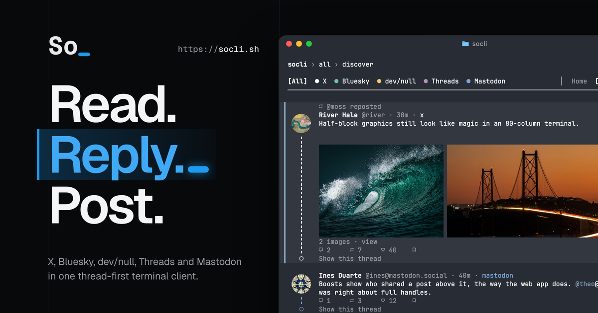

<p align="center">
  <picture>
    <source media="(prefers-color-scheme: dark)" srcset="design/brand/logo-dark.gif">
    
  </picture>
</p>

<h1 align="center">SoCLI - Social CLI</h1>

<p align="center">
  <strong>A So(cial)CLI(ché) thread-first terminal client.</strong><br />
  X, Bluesky, dev/null, Threads and Mastodon, in one reader
</p>

<p align="center">
  <a href="https://socli.sh"></a>
  <a href="LICENSE"></a>
  <a href="https://github.com/massimodeluisa/socli"></a>
  <a href="https://isready.ai"></a>
  <a href="https://agentskills.io"></a>
</p>

<p align="center">
  <a href="#install">Install</a> ·
  <a href="#sign-in">Sign in</a> ·
  <a href="#the-full-screen-reader">Reader</a> ·
  <a href="#one-shot-commands">Commands</a> ·
  <a href="#configuration">Configuration</a> ·
  <a href="CONTRIBUTING.md">Contributing</a>
</p>

<p align="center">
  
</p>

---

## What it does

SoCLI reads feeds, threads, profiles, mentions and search in a full-screen reader. A conversation is rails and a letter badge. The home timelines of the networks you signed in to sit in one list, with tabs for Home, Discover and Saved.

`--print` draws that same thread into the terminal scrollback, where you can copy it, page it, or pipe it. `socli post "hello" --net x,bluesky` is the client without a screen. That is the form a script or an agent runs.

This is what `--print` draws for the offline demo feed:

```text
  SoCLI › all › home                                                                Accounts   ⚑ 2

  All  ● X  ● Bluesky  ● dev/null  ○ Threads  ● Mastodon                │  [Home]  Discover  Saved
  ────────────────────────────────────────────────────────────────────────────────────────────────

   ╭───╮  Nuno Park ✓ @nuno · 50m · dev/null                                                     ⋯
   │ N │  ok devs, assemble. the reader is up.
   ╰─┬─╯
     ╎    notes: https://example.com/socli
     ╎
     ╎    ╭────────────────────────────────────────────────────────╮
     ╎    │ ↗ example.com                                          │
     ╎    │ SoCLI A thread-first terminal client for X, Bluesky, … │
     ╎    ╰────────────────────────────────────────────────────────╯
     ╎    ↩ 5             ♡ 86
     ╎    Show more
     ╎
     ╎   ╭───╮  Priya Shah @priya · 40m
     ├╌╌╌┤ P │  Hype
     ╎   ╰─┬─╯
     ╎   ╭─┴─╮  Juri Holm @juri · 28m
     ├╌╌╌┤ J │  The intro thread is the whole product.
     ╎   ╰─┬─╯
     ╎   ╭─┴─╮  Diego Martins @diego · 20m
     ╰╌╌╌┤ D │  Those were the fastest 18 hours of the build.
         ╰─┬─╯
           ○    Show 2 more replies

   ╭───╮  Nuno Park ✓ @nuno · 25m · dev/null                                                     ⋯
   │ N │  @you the prompt at the bottom is the whole navigation model.
   ╰─┬─╯
     ╎
     ╎    ↩ 0             ♡ 2
```

The sample was captured with `socli --demo --print --no-prompt --width 100 --no-icons` and `NO_COLOR=1`.

## Install

Run a published version without building Rust:

```sh
npx soclish
```

Or use `bunx soclish`. Use Node.js 22 or newer with npm, or `bunx --bun soclish` to run the launcher with Bun itself.

To keep the command on your `PATH`:

```sh
npm install --global soclish
socli --version
```

Install with Homebrew through the project tap:

```sh
brew tap massimodeluisa/tap
brew install socli
```

Package-manager installation requires a [published release](https://github.com/massimodeluisa/socli/releases), and Homebrew Core publication is pending; the project tap supplies the formula. If no release is listed, install from source:

```sh
cargo install --git https://github.com/massimodeluisa/socli
```

From a checkout:

```sh
git clone https://github.com/massimodeluisa/socli
cd socli
cargo build --release
```

The binary is `target/release/socli`. Copy it onto your `PATH` to call it as `socli`.

`rust-toolchain.toml` pins the compiler to `1.99.1`. rustup installs that compiler on the first build. The crate's minimum is Rust 1.89.

Shell completions:

```sh
socli completions zsh > ~/.zfunc/_socli
```

The argument is `bash`, `zsh`, `fish`, `elvish` or `powershell`. The rest of the install notes are in [website/docs/install.md](website/docs/install.md).

## First run

```sh
socli --demo
```

`--demo` opens an offline feed with posts from all five networks. It never touches the network, and the status row says `demo`. Likes, replies, reposts and bookmarks in the demo change the screen only. The demo also never writes `config.toml`. A change in Settings, the theme picker, the network filter or the detail picker lasts for the session, and the status shows `demo, not saved`.

[socli.sh](https://socli.sh) runs this same reader, compiled to WebAssembly, with the same keys and the same rails. With no account stored for that origin, the page opens the welcome screen. `/web/` is the reader on its own, at [socli.sh/web](https://socli.sh/web/).

Bluesky, Mastodon, Threads and X sign in from that screen. X and Threads approve the app compiled into the build. A build with an empty app id says so, and does not ask you to create one. The X reader on socli.sh returns to `https://socli.sh/` from the homepage and to `https://socli.sh/web/` from the full-screen page. Threads returns to `https://socli.sh/web/`, then sends the code to `https://socli.sh/threads/token`, which holds the app secret. Threads does not accept an `http://` redirect, so a reader on this machine (`http://127.0.0.1:5174`) cannot finish that approval.

X on the page uses the official API, so For you is a search, and a like or a follow can be refused. The local docs server forwards only `api.x.com` for that exchange. A static host such as GitHub Pages does not. dev/null on the page opens the approval on dev-null.sh, and you paste the `devnull://` callback. GitHub SSH signing stays in the terminal. `socli login x` in a terminal still imports the browser session. The page keeps its config, tokens included, in that origin's local storage. Rich mode draws profile pictures and post images by loading each one from its URL. kitty, iTerm2 and sixel stay in the terminal. The welcome screen can still open the offline demo.

Run `socli` with no arguments once you have signed in to at least one network. With no account and no `--demo`, an interactive terminal opens a sign-in screen, and that screen can still open the demo.

## Sign in

Each network has its own command. `socli auth status` shows what is configured and does not print secrets. `socli whoami` lists the accounts this process will use. Flags, scopes and environment variables are in `docs/integration/<network>/auth.md`.

`socli login x` reads the session already signed in inside Chrome, Brave, Edge, Arc or Chromium and stores it in the `[x]` section of `config.toml`. On a terminal it asks which profile to use, even when only one matches. `--browser` and `--profile` together skip that question when they match one session. That import imitates the x.com web client, and X may treat the calls as automation. `socli login x --oauth` is the path X sanctions. The menu row "A different account on x.com" approves the app compiled into SoCLI: the browser returns to `https://socli.sh/`, and socli.sh sends it on to `http://127.0.0.1:8741/callback`. A `--client-id` of your own is a different app, and that app needs `http://127.0.0.1:8741/callback` saved on it. See [docs/integration/x/auth.md](docs/integration/x/auth.md).

`socli login bluesky` asks for your handle and an app password from [bsky.app/settings/app-passwords](https://bsky.app/settings/app-passwords). It does not ask for the account password. For a script, `socli login bluesky --handle <handle> --password-stdin` reads the app password from standard input. See [docs/integration/bluesky/auth.md](docs/integration/bluesky/auth.md).

`socli login devnull` creates a device key and opens the browser. On macOS the window returns the result to SoCLI. On other platforms, or with `SOCLI_AUTH_BROWSER=manual`, paste the `devnull://` address back. Public reads work without that approval, and `socli auth devnull ssh` posts with the GitHub SSH key that signs your commits. See [docs/integration/devnull/auth.md](docs/integration/devnull/auth.md).

`socli login threads` opens Threads and asks you to approve SoCLI. The terminal returns to `https://socli.sh/`, which sends the browser on to `http://127.0.0.1:8742/threads/callback`. The code goes to `https://socli.sh/threads/token` and comes back as a 60-day token. `socli login threads --token <token>` stores a token you already have. See [docs/integration/threads/auth.md](docs/integration/threads/auth.md).

`socli login mastodon` asks for your server (Enter keeps `mastodon.social`), registers SoCLI as an app there, opens the authorization page and asks you to paste the code. `--server <host>` or `MASTODON_SERVER` skips the question. `socli login mastodon --token <token>` stores a token you created under Preferences > Development with the scopes `read write`, and it needs no browser. See [docs/integration/mastodon/auth.md](docs/integration/mastodon/auth.md).

`socli logout <network>` signs out of one network. `socli logout all` signs out of every network.

## The full-screen reader

`socli` opens the reader when stdout is a terminal and you pass neither `--json` nor `--print`. With more than one network signed in, the reader shows a merged timeline. Home is each network's primary feed. Discover is For you on X, Trending on dev/null and Mastodon, and Discover on Bluesky. Saved is bookmarks, plus the commits you starred on dev/null. Press `?` for the full key list. These are the ones you need first.

| Key | Action |
| --- | --- |
| `j` `k` or `↓` `↑` | move |
| `⏎` or `→` | open the thread, or show folded replies |
| `⌫`, `←` or `esc` | back |
| `tab` `shift-tab` | move the focus ring to the next or previous control, which `⏎` presses |
| `1`–`9`, `{` `}` | pick or cycle the feed tabs |
| `a` `A` | next network and then all, pick a network |
| `F`, `0`, `<` `>` | filter networks, show all, step through one network at a time |
| `f` or `/` | search |
| `:` or `ctrl-k` | the command line |
| `l` `t` `b` | like (favorite on Mastodon), repost, bookmark (again to undo; dev/null has no bookmarks) |
| `r` `n` | reply, new post |
| `ctrl-r` `cmd-r` | reload the page on screen |
| `u` `s` | the author's profile, share |
| `v` `o` | view images, open the link |
| `d` `D` | next detail level, pick the detail level |
| `,` | settings |
| `q` | quit |

In the composer, `⏎` sends, `ctrl-j` adds a newline, and `esc` goes back. `⇧⏎` adds a newline too, but only in terminals that report the kitty keyboard protocol, which SoCLI asks for through crossterm's `DISAMBIGUATE_ESCAPE_CODES`. `socli config set ui.enter newline`, or the Enter in composer row in Settings, swaps the two: `⏎` adds a newline and `ctrl-s` sends, as does `ctrl-⏎` in those terminals.

The field moves and deletes whole characters, accents and emoji included. `alt` or `ctrl` with `←` and `→` moves by word, and so do `alt-b` and `alt-f` (Option-Left and Option-Right when the terminal sends `esc b` and `esc f`). `Home` or `ctrl-a` and `End` or `ctrl-e` go to the ends of the line. `↑` and `↓` change line. `alt-⌫` or `ctrl-w` deletes a word, `ctrl-u` deletes to the start of the line, `ctrl-z` undoes and `ctrl-y` redoes. A paste goes in as text, newlines and all, and never sends.

Leaving a composer that holds text asks whether to save a draft. A send writes the draft before it reaches any network and removes it once every network has taken the post. After a failed send, the draft keeps the text and the networks that failed. `socli drafts` lists it, marked `may have posted` when SoCLI stopped before it knew the outcome.

Terminals that support OSC 8 hyperlinks (iTerm2, WezTerm, Ghostty, VS Code and others) open names, handles, mentions, times and links in the browser on Cmd-click or ctrl-click.

The reader also takes the mouse. A click on a post selects it and a second click opens it. A click on a name, a time, a link, a mention, a hashtag, a stats cell, a network chip, a feed tab, a nav section or a hint presses it, the same as moving the focus ring there and pressing `⏎`. The wheel moves the selection, or the cursor of an open picker or dialog, and hovering over a picker row moves the cursor to it. While SoCLI has the mouse, the terminal selects text only with Shift-drag (Option-drag in iTerm2). `--mouse off`, `SOCLI_MOUSE=off`, `socli config set ui.mouse off` or the Mouse row in Settings leaves the mouse to the terminal.

Work that needs the network runs on a worker thread. After 150 ms the footer shows `loading…`. Keys pressed in the meantime are dropped, and `ctrl-c` quits at once.

The [keys reference](website/docs/keys.md) has the rest of the reader, the composer, the dialogs and Settings.

## One-shot commands

Read commands open the reader at an interactive terminal. Add `--json` for JSON, or `--print --no-prompt` for text that prints once and exits. Writes with the text already supplied return after the operation. Every command, argument and option is in the [CLI reference](website/docs/commands.md).

```sh
socli feed saved --net bluesky --json
socli thread x:1849213377 --print --no-prompt
socli search rust tui --json
socli post "hello from a terminal" --net x,bluesky
socli reply bluesky:at://… "agreed"
socli quote x:1849213377 "this"
socli like x:1849213377
socli delete x:1849213377 --yes
```

Ids are scoped as `<network>:<native id>`, and a post link works in place of an id. `--net` takes `x`, `bluesky`, `devnull`, `threads`, `mastodon` (or `masto`), a comma list, or `all`. Without it, SoCLI uses `SOCLI_NET`, then `feed.networks`, then every signed-in network. `post` uses `socli auth default`. `--dry-run` checks sign-in, capabilities and length, and sends nothing. `--json` prints an array of posts for a read, and an array of per-network results for a write. `<b>` and `<i>` in post text become Unicode bold and italic letters. `--raw` sends the text as typed.

`socli help` lists every command. `socli help <command>` shows one command's flags and examples. `socli help --json` returns that table as JSON. Beyond the examples above, the help page covers `user`, `notifications`, `bookmarks`, `ask`, `repost`, `bookmark`, `share`, `follow`, `whoami`, `auth`, `config`, `drafts`, and the undo form of each toggle (`unlike`, `unrepost`, `unbookmark`, `unfollow`).

## Detail levels

The detail level is how much art the reader and `--print` draw. Set it with `--detail`, `SOCLI_DETAIL` or `ui.detail`. With none of those set, a normal terminal opens at rich. An ESP terminal, or a `TERM` of `dumb`, `unknown`, `ansi`, `vt52`, `vt100`, `vt102`, `vt220` or `network`, opens at plain. In the reader, `d` steps to the next level and `D` opens a picker. Either choice is written to `ui.detail` and used the next time you open SoCLI. `--detail` and `SOCLI_DETAIL` still win over the saved value. A narrow terminal changes the layout, and never the level.

| Level | What it draws |
| --- | --- |
| `plain` | No color, ASCII chrome, and `>` marks the selected post |
| `minimal` | No boxes or icons in posts, and a colored side line per network |
| `medium` | Rails, letter badges and a one-line media row, drawn to the edges |
| `rich` | Medium, plus inline images, link preview images, profile pictures and turning spinners |

Link preview images come from the network's card data or from the page's `og:image`. Turn the page fetch off with the Fetch link pages setting, or with `ui.unfurl`. Rich previews appear in the full-screen reader and not in `--print`.

## Split view

On a terminal at least 124 columns wide, the reader shows the feed on the left and the selected thread on the right. `--layout split` lowers that to 100 columns. `--layout single` turns the split off. The setting is `ui.layout`. `⏎` moves the keys into the thread, `⌫` or `esc` moves them back to the feed, and the side without the keys is dimmed.

## Narrow terminals

Medium draws to the edges at every width. Below 60 columns the other levels drop their side margins. The reader drops the nav row, collapses the network chips into one chip that opens the network picker, and moves a long author line's handle, time and network under the name. Below 39 columns the stats pack into one row from the text column, without the views count. The reader needs at least 24 columns and 8 rows. A smaller terminal shows only `SoCLI needs 24×8 · q quits` until it grows again. `--print` with a `--width` under 24 prints at 24 columns.

## Images and icons

Images need a graphics protocol: kitty, iTerm2 or sixel. Without one, SoCLI paints half blocks. Inside tmux it always uses half blocks. Apple Terminal always uses half blocks too, and SoCLI does not send it the kitty probe, because Terminal prints that probe, and any kitty or iTerm image, as text. `--images[=auto|kitty|iterm|sixel|blocks|off]`, `SOCLI_IMAGE`, `ui.images` and the Settings screen choose the mode. In `sixel` mode, inline images use sixel, while the full-screen viewer and `--print` use half blocks, because the viuer library is built without sixel. Profile pictures replace the letter badges only with kitty, iTerm2 or sixel graphics. Cursor and VS Code draw images only when `terminal.integrated.enableImages` is on. Pictures from posts and link pages load only from public addresses, and SoCLI checks every redirect before it follows one. A local file opens only when you pass its path to `socli view <path>`.

In `auto` icon mode, SoCLI selects Nerd Font glyphs in Ghostty and WezTerm, and Unicode icons in other terminals. Install a Nerd Font, select it in the terminal, then pass `--icons nerd`. `--no-icons` (or `NO_ICONS`) switches to Unicode icons that need no special font. `--icons auto|nerd|unicode` picks a set. The font and its size are terminal settings. In Cursor those are `terminal.integrated.fontFamily` and `terminal.integrated.fontSize`. A terminal program cannot change them.

## Themes

SoCLI ships `auto` (black or white, following the terminal background), `native` (the terminal's own colors and a transparent background), `black`, `white`, and 27 named palettes adapted from opencode, such as `nord`, `gruvbox` and `catppuccin`. A named theme follows the terminal: it uses its light variant on a light terminal when it has one, and `nord-dark` or `nord-light` forces a variant. `socli config themes` lists every name. Choose one with `--theme`, `SOCLI_THEME`, `ui.theme`, the Theme row in Settings, or `:theme`, which opens a picker that previews each theme as the cursor moves. The palettes are credited in [THIRD-PARTY-NOTICES.md](THIRD-PARTY-NOTICES.md).

## Configuration

SoCLI reads `$SOCLI_CONFIG_DIR/config.toml`, else `$XDG_CONFIG_HOME/socli/config.toml`, else `~/.config/socli/config.toml`. The file has mode `0600` in a directory with mode `0700`, and every write replaces it atomically. `socli config path` prints the location. `socli config list` shows every key with its value or default. `socli config set <key> <value>` validates and saves one key.

```sh
socli config set ui.theme nord
socli config set feed.networks bluesky,threads
socli config get ui.detail
```

The environment overrides several settings: `SOCLI_NET`, `SOCLI_THEME`, `SOCLI_DETAIL`, `SOCLI_LAYOUT`, `SOCLI_IMAGE`, `NO_COLOR`, `NO_ICONS` and others. [docs/CONVENTIONS.md](docs/CONVENTIONS.md#configuration-and-secrets) lists every variable, and the order in which flags, environment and the file apply.

## AI agents

When an AI coding agent runs SoCLI, agent mode turns on by itself. Output is JSON, nothing prompts, and no key is read. [docs/agents.md](docs/agents.md) describes the detection, the JSON shapes, the exit codes and the sign-in limits. `docs/agents/socli/SKILL.md` is a ready-to-install Claude Code skill.

## Limits

- X sign-in needs a browser once, and reads are pay-per-use, so SoCLI does not page until you ask. See [docs/integration/x/README.md](docs/integration/x/README.md).
- Bluesky signs in with an app password, and public search is blocked without a session. See [docs/integration/bluesky/README.md](docs/integration/bluesky/README.md).
- dev/null feeds and notifications need an approved device, and notifications are marked read when listed. See [docs/integration/devnull/README.md](docs/integration/devnull/README.md).
- Threads has no home timeline and no likes in its API, profiles only for the signed-in account, and reposts cannot be undone. See [docs/integration/threads/README.md](docs/integration/threads/README.md).
- Without an account, Mastodon opens only threads and profiles, because servers such as mastodon.social keep their live feeds closed to signed-out readers. The post limit is the one your server reports (500 by default). See [docs/integration/mastodon/README.md](docs/integration/mastodon/README.md).
- Reddit is not integrated. See [docs/integration/reddit/README.md](docs/integration/reddit/README.md).
- A terminal app cannot intercept Cmd+C, because the terminal keeps it for copying.

## Documentation

[docs/INDEX.md](docs/INDEX.md) lists the design system, the code conventions, the network pages, the agent guide and the mockup gallery, and says when to read each one.

## Author

<p>
  <a href="https://x.com/massimodeluisa"></a>
  <a href="https://github.com/massimodeluisa"></a>
</p>

Massimo De Luisa: [massimo.deluisa.bio](https://massimo.deluisa.bio)

## License

MIT, see [LICENSE](LICENSE).
